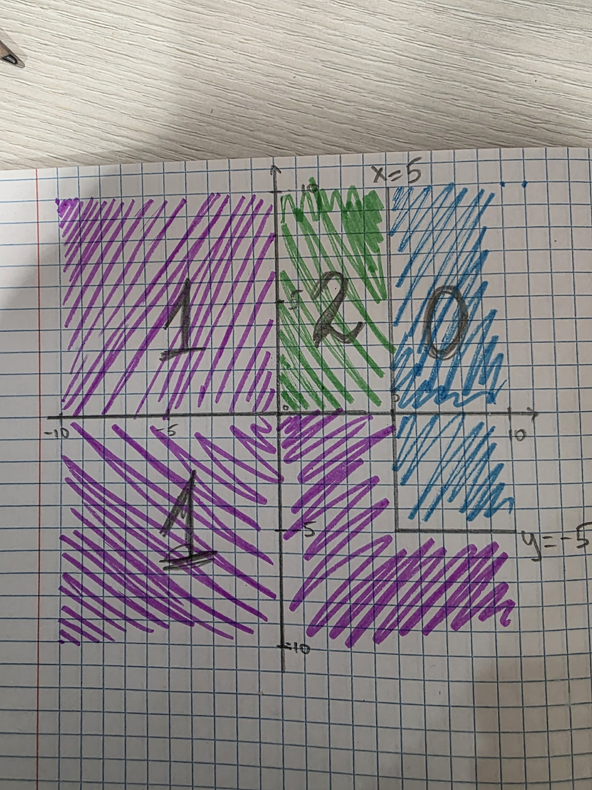

# Языки программирования
## Лабораторная работа 8

### Задание 1 **(2)**
*Рассмотрим программу на языке* **Python**.
```
x = [int(t) for t in input().split()]
for i in range(len(x)):
   if x[i] < i or x[i] > 2*i:
      break
print(i)
```
*Перепишите эту программу так, чтобы в ней использовался цикл* **while**, *в ней не использовалась
инструкция* **break**, *а используемый алгоритм не изменился. Полученная программа должна иметь следующий 
вид.*
```
x = [int(t) for t in input().split()]
i = 0
while ...:
   i += 1
print(i)
```
*Допишите правильное логическое выражение вместо многоточия. Выражение не должно содержать оператор* **not**.

В исходной программе цикл останавливается с помощью `break`, когда срабатывает условие: `x[i] < i or x[i] > 2*i`.
Чтобы избавиться от `break` и перенести проверку в сам цикл `while`, нам нужно условие, при котором цикл наоборот должен продолжать работать. То есть противоположное условие.
Противоположным для "меньше `i` или больше `2*i`" будет отрезок от `i` до `2*i`.

Также нужно проверять, чтобы индекс не вышел за пределы списка (`i < len(x)`).

Получается такая программа:
```
x = [int(t) for t in input().split()]
i = 0
while i < len(x) and i <= x[i] <= 2 * i:
   i += 1
print(i)
```

Пока `i` не дошла до конца и выполняется двойное неравенство `i <= x[i] <= 2*i`, счетчик `i` увеличивается на 1. Как только условие нарушается — цикл сразу останавливается, и выводится текущее значение `i`.

### Задание 2 **(2)**
*Рассмотрим программу на языке* **Python**.
```
x = [int(t) for t in input().split()]
for i in range(len(x)):
   if i <= x[i] < 2*i or 3*i <= x[i] < 4*i:
      break
print(i)
```
*Перепишите эту программу так, чтобы в ней использовался цикл* **while**, *в ней не использовалась
инструкция* **break**, *а используемый алгоритм не изменился. Полученная программа должна иметь следующий 
вид.*
```
x = [int(t) for t in input().split()]
i = 0
while ...:
   i += 1
print(i)
```
*Допишите правильное логическое выражение вместо многоточия. Выражение не должно содержать оператор* **not**.

Все также, как в первом номере. Исходный цикл прерывается, если `x[i]` попадает в диапазон `[i; 2*i)` или в диапазон `[3*i; 4*i)`.
Чтобы цикл шел дальше без `break`, элемент не должен попадать ни в один из этих двух диапазонов.

Для первого диапазона противоположное условие: `(x[i] < i or x[i] >= 2*i)`.
Для второго: `(x[i] < 3*i or x[i] >= 4*i)`.
И оба этих условия должны выполняться через `and`.

Правильный вариант:
```
x = [int(t) for t in input().split()]
i = 0
while i < len(x) and (x[i] < i or x[i] >= 2 * i) and (x[i] < 3 * i or x[i] >= 4 * i):
   i += 1
print(i)
```

### Задание 3 **(2)**

*Напишите пример программы на* **Java** *с двумя вложенными циклами и инструкцией* **break** *для выхода
из двух вложенных циклов. В качестве такой программы можно взять поиск первого нуля в двумерном массиве.*

Обычный `break` в Java выходит только из того цикла, в котором он написан. Чтобы прервать сразу два цикла, перед внешним циклом ставится метка (например, `stop:`), и пишется `break stop;`.

```
public class Main {
    public static void main(String[] args) {
        int[][] a = {
            {1, 2, 3},
            {4, 0, 6},
            {7, 8, 9}
        };

        search:
        for (int i = 0; i < a.length; i++) {
            for (int j = 0; j < a[i].length; j++) {
                if (a[i][j] == 0) {
                    System.out.println("Zero found at: [" + i + "][" + j + "]");
                    break search;
                }
            }
        }
    }
}
```

Когда программа доходит до нуля в строке 1 (`a[1][1]`), срабатывает `break stop;` и выполнение программы сразу выходит за пределы обоих циклов, поэтому второй ноль в третьей строке уже не ищется.

### Задание 4 **(2)**

*Рассмотрим программу на языке* **Python**.
```
a = list(range(10))
b = [a.pop() - x for x in a]
print(*b)
```
*Объясните, почему список* **b** *получился именно таким.*

Если запустить эту программу, список выведет числа: `9 7 5 3 1`.

Почему так получается:
Изначально список `a = [0, 1, 2, 3, 4, 5, 6, 7, 8, 9]`.
В цикле переменная `x` идет по элементам списка слева направо (по индексам 0, 1, 2...), но внутри выражения одновременно вызывается `a.pop()`, который отрезает последний элемент с конца списка.

Шаги:
1. Берем индекс 0: `x = 0`. Вызываем `a.pop()` — он забирает последний элемент 9. Получаем: `9 - 0 = 9`. В списке `a` осталось 9 элементов.
2. Берем индекс 1: `x = 1`. Вызываем `a.pop()` — забирает 8. Получаем: `8 - 1 = 7`. В списке `a` осталось 8 элементов.
3. Берем индекс 2: `x = 2`. `a.pop()` забирает 7. Получаем: `7 - 2 = 5`.
4. Берем индекс 3: `x = 3`. `a.pop()` забирает 6. Получаем: `6 - 3 = 3`.
5. Берем индекс 4: `x = 4`. `a.pop()` забирает 5. Получаем: `5 - 4 = 1`. В списке `a` остались элементы `[0, 1, 2, 3, 4]`.
6. Цикл хочет перейти к индексу 5, но длина списка `a` теперь всего 5 элементов (индексы от 0 до 4). Список закончился, и цикл просто останавливается.

Поэтому получилось только 5 чисел: `9 7 5 3 1`.

### Задание 5 **(2)**

*Напишите программу на С++, которая прочитает натуральное число* **n**, *создаст вектор
из* **n** *элементов, прочитает значения элементов, добавит последний элемент вектора к каждому элементу 
(в том числе и к последнему), найдет и выведет количество положительных и отрицательных элементов вектора
после изменения. Из циклов в программе можно использовать только циклы по коллекции.*

```
#include <iostream>
#include <vector>

using namespace std;

int main() {
    int n;
    cin >> n;

    vector<int> v(n);
    for (int &x : v) {
        cin >> x;
    }

    int last = v[n - 1];

    for (int &x : v) {
        x += last;
    }

    int pos = 0;
    int neg = 0;

    for (int x : v) {
        if (x > 0) pos++;
        if (x < 0) neg++;
    }

    cout << "Positive: " << pos << endl;
    cout << "Negative: " << neg << endl;

    return 0;
}
```

В программе используются только циклы по коллекции (`for (int &x : a)`). Последний элемент сохраняем в переменную `last` заранее, потому что если прибавлять его прямо на ходу, то в самом конце он бы изменился и прибавился неправильно.

### Задание 6 **(3)**

*Представим, что в некотором будущем стандарте* **С++** *появится конструкция*
```
forc(i, from, to)
```
*которая будет раскрываться в следующий код.*
```
{
   int __i = from, __n=to;
   for(const int &i= __i; i < __n; __i++) {
      ...
   }
}
```
*Чем эта конструкция отличается от стандартного цикла* **for**? *Укажите два основных различия.
Напишите программы для демонстрации этих различий.*

*Написанные программы сохраните в папку с номером задания.*

Отличие:
1. Переменную цикла `i` нельзя изменить руками внутри тела, потому что она создана как константная ссылка `const int &i`. В обычном цикле `for` мы можем написать `i = 10;`, а тут компилятор выдаст ошибку.
2. Конечное значение `to` вычисляется ровно один раз в самом начале (в переменную `__n`), а не пересчитывается на каждом шаге, как в обычном `for`.

Первое отличие (нельзя менять переменную `i`):
```
#include <iostream>
using namespace std;

int main() {
    int from = 0, to = 5;

    // В обычной инструкции for переменную цикла можно менять:
    for (int i = from; i < to; i++) {
        // i = 10; // скомпилируется
    }

    // В цикле forc:
    // int __i = from, __n = to;
    // for (const int &i = __i; i < __n; __i++) {
    //     i = 10; // Ошибка компиляции: i является константной ссылкой
    // }

    cout << "Difference 1: i is constant inside the loop body" << endl;
    return 0;
}
```

Второе отличие (граница считается один раз):
```
#include <iostream>
using namespace std;

int get_to() {
    cout << "get_to() called" << endl;
    return 3;
}

int main() {
    // В цикле forc:
    // граница вычисляется ровно один раз при инициализации int __n = to;
    int __i = 0, __n = get_to();
    for (const int &i = __i; i < __n; __i++) {
        cout << "i = " << i << endl;
    }

    return 0;
}
```

### Задание 7 **(2)**

*Напишите программу на языке* **Python** *для проверки того, что все числа во введенной 
последовательности неотрицательные. Если в цикле будет найдено отрицательное число, цикл должен
прерваться и вывести найденное число. Если отрицательных чисел нет, то вывести некоторое сообщение об этом.*

*Программа должна использовать конструкцию* **for break else**.

```
a = [int(x) for x in input().split()]

for x in a:
    if x < 0:
        print("Найдено отрицательное число:", x)
        break
else:
    print("Все числа неотрицательные")
```

*Запишите аналогичную программу на С++. Какие изменения в алгоритме решения в ней появились?. Почему?*

```
#include <iostream>
#include <vector>

using namespace std;

int main() {
    int n;
    if (!(cin >> n)) return 0;

    vector<int> a(n);
    for (int &x : a) {
        cin >> x;
    }

    bool found = false;
    for (int num : a) {
        if (num < 0) {
            cout << "Found negative number: " << num << endl;
            found = true;
            break;
        }
    }

    if (!found) {
        cout << "All numbers are non-negative" << endl;
    }

    return 0;
}
```

В C++ нет ветки `else` у циклов, как в Python. В Python блок `else` выполняется сам, если цикл прошел до конца без `break`. В C++ для этого приходится заводить простую переменную-флаг (`bool found = false`). Если нашли отрицательное число, ставим флаг в `true`, а после цикла проверяем через обычный `if (!found)`.

### Задание 8 **(2)**

*Рассмотрим следующую программу.* 
```
if x>=5 and y>=-5:
   print(0)
elif x<0 or y<0:
   print(1)
else:
   print(2)
```
*Нарисуйте на координатной плоскости множества значений при которых программа выводит 0, 1 и 2.*
*Фотографию рисунка вставьте в отчет*
*Опишите эти множества значений, используя язык теории множеств. Например,*

$A = \{ (x,y) \mid x \in [5;\infty), y \in [-5;\infty) \}$.

1. Программа выводит 0, когда выполняется первое условие:
$$A = \{ (x,y) \mid x \in [5;\infty), y \in [-5;\infty) \}$$
Это угол плоскости, где $x \ge 5$ и $y \ge -5$.

2. Программа выводит 1, если первое условие не подошло, но выполнилось `x < 0 or y < 0`:
Сюда попадают точки, где либо $x < 0$, либо $y < 0$, кроме тех, которые уже забрало первое условие (то есть кроме области, где одновременно $x \ge 5$ и $y \ge -5$):
$$B = \{ (x,y) \mid (x < 0 \lor y < 0) \setminus A \}$$
Проще говоря: это вся плоскость ниже $y = -5$, а также область $y \in [-5; 0)$ при $x < 5$, и область $x < 0$ при $y \ge 0$.

3. Программа выводит 2 во всех остальных случаях (`else`):
Это когда ни одно из условий выше не сработало. То есть не отрицательные координаты ($x \ge 0$ и $y \ge 0$), но при этом $x$ еще не дошел до 5:
$$C = \{ (x,y) \mid x \in [0; 5), y \in [0; \infty) \}$$



###  Задание 9 **(3)**
*Напишите программу на языке Python для решения следующей задачи.*

*Задана пронумерованная последовательность логических значений* **t(0), t(1), ..., t(n)**, **t(i) ∈ {False, True}**

*Последовательность обладает следующим свойством: существует некоторое число k такое, что 
все значения* **t(0), t(1), ..., t(k-1)** *равны* **False**, *а все значения* **t(k), ..., t(n)** *равны* **True**,
*то есть слева от* **k** *находятся значения* **False**, *а справа* - **True**. *Последовательность задается
функцией* **t(i)**, *которая возвращает логическое значение. Например, для тестирования эту функцию можно
задать следующим образом.*
```
def t(i):
   return i >= 1000
```

*Требуется написать программу, которая найдет число* **k**. *Программа должна реализовывать алгоритм 
бинарного поиска. Диапазон поиска задается переменными* **left** и **right**. *На каждом шаге вычисляется
центр диапазона, значение в нем проверяется, после чего диапазон сокращается в два раза.*

*Алгоритм должен быть записан через цикл* **while** *и реализовывать инвариант цикла*

$t(left) = \text{False} \land t(right) = \text{True}$

```
def t(i):
   return i >= 1000

left = -1
right = 10**18

while right - left > 1:
   mid = (left + right) // 2
   if t(mid):
      right = mid
   else:
      left = mid

print(right)
```

Мы берем левую границу `left = -1` (для нее функция точно `False`), а правую границу берем с запасом `right = 10**18` (для нее `True`).
На каждом шаге находим середину `mid = (left + right) // 2`.
Если функция возвращает `True`, сдвигаем правую границу: `right = mid`.
Если `False`, сдвигаем левую границу: `left = mid`.
Цикл идет до тех пор, пока `right - left > 1`. Когда они сойдутся вплотную, `left` останется на последнем `False`, а `right` будет показывать на самый первый `True`, то есть ровно на число `k`. Поэтому в конце выводим `right`.